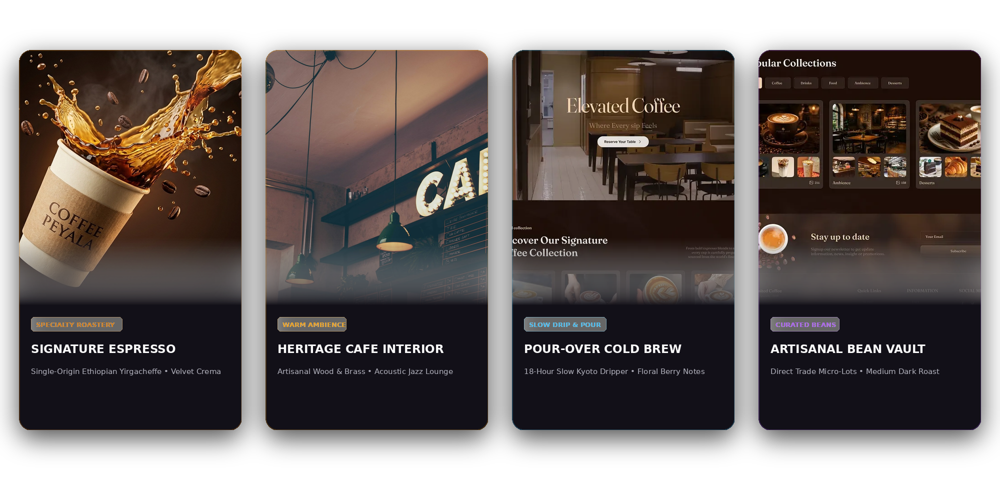

<div align="center">

# ☕ COFFEE PEYALA — Artisanal Specialty Coffee & Roastery
### Immersive Specialty Brew House & Table Reservation Experience Powered by React 19 & Tailwind CSS v4

[](https://coffeepeyala.pages.dev/)
[](https://react.dev/)
[](https://vitejs.dev/)
[](https://tailwindcss.com/)
[](https://www.npmjs.com/package/canvas-confetti)
[](https://coffeepeyala.pages.dev/)
[](LICENSE)

<br/>

**[⚡ View Live Production Deployment](https://coffeepeyala.pages.dev/)** &nbsp;•&nbsp; **[📦 GitHub Repository](https://github.com/labibfohayer/Coffee-Shop-Website)**

<br/>



</div>

---

## 📌 Architectural Overview

**Coffee Peyala (কফির পেয়ালা)** is an ultra-modern artisanal coffee house and specialty roastery web application. Built for coffee purists and urban cafe enthusiasts, the platform seamlessly translates the sensory richness of single-origin brewing into an engaging digital interface—featuring live table booking, bean origin explorer, and interactive menu filtering.

Built upon **React 19**, **Vite 6**, and **Tailwind CSS v4**, the architecture achieves zero layout shift, ultra-fast client-side state reactivity, and rich micro-interactions with **Canvas Confetti**.

---

## ⚡ Key Engineering Highlights

1. **Curated Roast & Brew Showcase:**
   - 4 Signature coffee experiences: Single-Origin Espresso, Heritage Cafe Ambiance, Slow Kyoto Pour-Over, and Curated Micro-Lot Bean Vault.
   - Dynamic temperature, milk-alternative, and grind-profile selectors.

2. **Real-Time Table Booking Engine:**
   - Interactive date, time-slot, and seating area picker with instant confirmation feedback and celebration confetti triggers.

3. **High-Performance Static Delivery:**
   - Pre-compressed WebP image assets and zero runtime CSS overhead powered by the new Tailwind v4 engine.

---

## 🛠️ Tech Stack & Production Architecture

| Layer | Technologies | Purpose |
| :--- | :--- | :--- |
| **Framework** | React 19, TypeScript, Vite 6 | High-speed component rendering and modern ES module builds |
| **Styling** | Tailwind CSS v4, Lucide Icons | Ultra-fast CSS compilation and sleek minimal vector icons |
| **Interactive UX** | Canvas Confetti, Form State Hooks | Fluid booking confirmations and tactile sensory feedback |
| **Edge Distribution** | Cloudflare Pages, Global CDN | Ultra-fast edge delivery across global POP locations |

---

## 🚀 Getting Started & Local Development

```bash
# Clone the repository
git clone https://github.com/labibfohayer/Coffee-Shop-Website.git
cd Coffee-Shop-Website

# Install dependencies
npm install

# Start Vite dev server
npm run dev
```

Open [http://localhost:5173](http://localhost:5173) to view the live development server.

---

## 📄 License
This project is open-source and distributed under the [MIT License](LICENSE).
